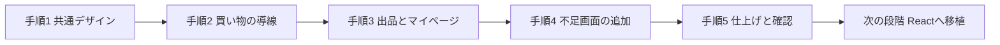

# Re:Tailor フロントエンド進行書

作成日：2026年10月20日
対象：`プロトタイプ/`（HTML・CSS・JavaScript で作った画面）

この文書は、「どの画面を、どんな順番で、どこまで直すか」を、専門知識がない人でも判断できるようにまとめたものです。難しい言葉には、そのつど説明を付けています。

---

## 1. 目的とゴール

### 目的

Re:Tailor の画面を、**どの画面を開いても同じサイトに見え、迷わず操作できる状態**にする。

### ゴール（これが全部できたら完了）

| No. | ゴール | 確認のしかた |
| --- | --- | --- |
| 1 | 全画面で、色・文字・ボタンの形が同じ | 画面を順に開いて見比べる |
| 2 | 「トップ → 探す → 商品を見る → カート → 購入 → 完了」が迷わず進める | 実際に最後まで操作する |
| 3 | 「出品する → 一覧で確認 → 編集 → 取り下げ」が迷わず進める | 実際に最後まで操作する |
| 4 | 企画資料にある画面が、全部そろっている | 3章の「足りない画面」がなくなる |
| 5 | スマホ幅でも、横にはみ出したり重なったりしない | 幅 320px / 768px / 1440px で確認 |
| 6 | マウスを使わず、キーボードだけでも主要な操作ができる | Tab キーで操作する |

### 今回やらないこと

- 本物のサーバー・データベースとの接続（今は `localStorage`＝ブラウザ内の仮保存で動かしている）
- `Re-Tailor/retailor-frontend`（React 版）への移植。ただし将来の方針は8章に書く
- 企画書にない新機能の追加

---

## 2. 現状サマリー

### 2.1 全体の様子

| 項目 | 内容 |
| --- | --- |
| 画面数 | 一般向け 38 画面（調査時は 36 画面。今回 2 画面を追加）、管理者向け 13 画面 |
| コード量 | HTML 約 2,950 行 / CSS 約 4,630 行 / JavaScript 約 3,130 行 |
| 総合評価 | 85 点（B）。出典：`プロトタイプ総合評価.md`（2026年9月29日） |
| 管理者画面 | 仕様表があり、色・文字もそろっていて品質が高い |
| 一般画面 | 画面ごとに作りが違い、見た目にばらつきがある |

### 2.2 評価の内訳（総合評価より）

| 領域 | 評価 | 一言で言うと |
| --- | --- | --- |
| 画面のそろい具合 | A- | 主要画面は一通りある |
| 見た目・操作感 | B- | **画面ごとに差がある（今回の主題）** |
| 画面遷移 | B+ | 主要な流れはつながっている |
| データのつながり | B | 購入・出品・お気に入りは画面間で共有できている |
| 入力チェック・状態 | B | 空の状態・エラーも多くの画面にある |
| アクセシビリティ | C+ | **キーボード操作や読み上げ対応が弱い** |
| スマホ対応 | B- | 管理画面は確認済み、一般画面は未確認 |

### 2.3 調査で見つけた「ばらつき」

画面を作った人が違うため、同じ意味のものが画面ごとに別々に定義されています。

| 見つかったこと | 具体的な状況 | 困ること |
| --- | --- | --- |
| 色の決め方が別々 | CSS 約 30 本のうち 23 本が、それぞれ独自の色の定義（`:root`）を持つ | 色を1か所変えても全画面に反映されない |
| 文字の種類が混在 | 日本語フォントの指定が約 13 通り（Arial 系、Hiragino 系、Georgia、Fraunces など） | 画面ごとに文字の雰囲気が変わる |
| グレーが多すぎる | 同じようなグレーが十数種類 | 画面ごとに少しずつ色が違って見える |
| 購入画面だけ配色が別 | `buy-style.css`（`buy.html`・`confirm.html`）は枠線が黒、背景が `#f5f5f5` で他と違う | 買い物の最後だけ雰囲気が変わる |
| スマホ対応の抜け | `login.css` に画面幅ごとの調整（`@media`）がない | ログイン・新規登録がスマホで崩れるおそれ |
| 外部サービスに依存 | トップ・アバウトは Google Fonts、`search.html` は Font Awesome（アイコン）を外部から読み込む | ネットにつながらないと文字・アイコンが変わる |
| 使っていないファイル | `static/style.css` はどの画面からも読み込まれていない | 整理が必要 |
| フッターの有無 | `login.html`・`signup.html` は共通フッターを読み込んでいない | 要件書は共通フッターの表示を求めている（要確認） |

良い点も確認できています。`href="#"`（行き先のないリンク）と、画像の `alt` 抜けは検索では見つかりませんでした。

---

## 3. 企画資料と画面の突き合わせ

### 3.1 参照した資料

優先順位は `プロトタイプ画面作成要件書.md` の 2.1 に従います。

1. 企画書（`IH22_02_新サービス企画書…pptx`）：コンセプト「わたしらしさ、見つかる場所」
2. サイトマップ（`IH_Hgroup_サイトマップ.pptx`）
3. 画面イメージ（`Re-Tailorイデア (1).pptx`）：画面 15 枚
4. 画面設計書（`画面設計書 (1).xlsx`）：画面一覧とトップ・購入・カート・ログインなど 9 画面
5. テーブル定義書（`IHテーブル定義書 (1).xlsx`）、外部IF仕様書（`外部IF仕様書.xlsx`）
6. 要件書・総合評価・お問い合わせ仕様・管理者仕様

### 3.2 サイトマップにあるが、画面がまだないもの

| 資料上の画面 | 対応 | 状態 |
| --- | --- | --- |
| お気に入り一覧 | `favorites.html` を追加。マイページから入れる | 完了（2026年10月20日） |
| ユーザー設定（通知・言語・プライバシー・ログアウト・退会） | `settings.html` を追加。会員情報・パスワード変更・本人確認・お支払い方法・ヘルプへ入れる | 完了（2026年10月20日） |

### 3.3 資料と現状に差があるもの（確認結果）

要件書のルールにより、**勝手に決めず、差を記録してから確認**します。

| 項目 | 資料の内容 | 確認結果・対応 |
| --- | --- | --- |
| 配送方法の選択 | 購入手続きに「配送方法（メルカリ便 ¥210・ゆうパック ¥600）」がある | `buy.html` に項目はあった。送料を合計に反映し、確認画面・購入履歴詳細にも表示するようにした |
| 商品詳細の下部固定バー | 「お気に入り / カート追加 / 購入手続き」を画面下に固定表示 | 「カートに追加」がなかったため追加。スマホ幅（680px 以下）で画面下に固定表示 |
| 検索結果の並び替え | 「新着順・価格順」で並び替え、件数表示 | 価格帯の絞り込みと「おすすめ順／価格が安い順／価格が高い順」を追加。**新着順は、商品データに出品日がないため未対応** |
| カートの数量変更 | 「− 1 +」で数量を変える | 商品は 1 点ものなので数量変更は設けない（商品詳細にも「在庫：1点のみ」と表示）。資料との差として記録 |
| 商品画像の複数枚表示 | スワイプで複数枚、ドットで枚数表示 | 画像データがないため未対応（本番の画像ができた段階で対応） |
| 画面切り替え | ヘッダーに「ショッピング ⇄ スタイル相談」のトグル | 現状は別々の入口。**仕様の確認待ち** |
| 送料の負担者 | 資料・購入手続きは購入者が送料を負担。出品画面・商品詳細は「出品者負担（送料込み）」 | **食い違いのまま。どちらを正とするか確認してから統一する**（`プロトタイプ総合評価.md` P2） |

---

## 4. やること（5つの手順）

### 手順1：共通デザインの土台をつくる

「色・文字・ボタン・入力欄・カード」を**1つのファイルにまとめ**、全画面が同じものを使う状態にします。

| やること | 内容 |
| --- | --- |
| 共通CSSを新規作成 | `static/common-base.css`（仮称）。色・文字・余白・ボタン・入力欄・カードを定義 |
| 色を決める | 基本は白・濃いグレー・オリーブ（`#3f4a2e`）。要件書 4.1 に従う |
| 文字を決める | 日本語は `"Hiragino Kaku Gothic ProN", "Yu Gothic", "Meiryo", sans-serif` に統一 |
| 外部依存を減らす | Google Fonts・Font Awesome が読めなくても崩れない代替指定を入れる |
| 段階的に適用 | 1画面ずつ共通CSSを読み込み、画面固有の重複定義を削る |
| 不要ファイルを整理 | `style.css` が不要か確認してから扱いを決める |

完了の目安：共通CSSを読んだ画面で、色・文字・ボタンを1か所変えると全部に反映される。

### 手順2：買い物の主導線を直す（最優先）

使う人が最も多く通る道です。「迷わない・間違えない」を重視します。

流れ：`top-index` → `search` → `detail` → `cart` → `buy` → `confirm` → 完了

| 画面 | 直すこと（案） |
| --- | --- |
| `top-index.html` | 商品・カテゴリ・検索への入口を整理し、主ボタンを目立たせる |
| `search.html` | 検索結果の件数、並び替え、絞り込みの見やすさを改善（資料の画面5に合わせる） |
| `detail.html` | お気に入り・カート追加・購入手続きを近くにまとめる。主操作は「購入手続きへ」の1つ |
| `cart.html` | 合計金額・送料・数量変更を見やすくする（資料の画面7に合わせる） |
| `buy.html` | 入力の順番（お届け先 → 支払い → 配送 → 注文内容）と、エラーの出し方をそろえる |
| `confirm.html` | 入力内容の確認と「戻る」の分かりやすさ。配色を共通化する |

### 手順3：出品・マイページ系をそろえる

| 画面グループ | 対象ファイル |
| --- | --- |
| 出品 | `syuppin_itiran` / `syuppin` / `syuppin_complete` / `naiyouhensyuu` / `torisage` |
| マイページ | `my-page` / `profile-edit` / `member-profile` / `identity-verification` / `password` / `billing-portal` |
| 履歴・評価 | `purchase-history` / `purchase-history-detail` / `seller-history` / `seller` / `review` / `hyouka_review` |
| その他 | `notification` / `notification-detail` / `help` / `contact` / `contact-complete` |
| ログイン | `login` / `signup`（スマホ対応とフッターの扱いを含む） |
| 相談・診断 | `ai-chat` / `personality` / `coordinate_shindan` / `my-closet` |

### 手順4：足りない画面を追加する

| 追加する画面 | 内容 | 入口 | 戻り先 |
| --- | --- | --- | --- |
| お気に入り一覧 | 保存した商品をカードで並べ、ハートで解除（資料の画面8） | マイページ・ヘッダー | マイページ |
| ユーザー設定 | 通知・言語・プライバシー・ヘルプ・ログアウト・退会（資料の画面12） | マイページ | マイページ |

追加するたびに、`プロトタイプ画面作成要件書.md` の 5.2「現在の主要導線」の表へ、起点・操作・遷移先・戻り先を書き足します。

### 手順5：仕上げと確認

| 確認 | 内容 |
| --- | --- |
| 画面幅 | 320px / 768px / 1440px で、はみ出し・重なり・読みにくい折り返しがない |
| キーボード | Tab キーだけで、購入・出品・プロフィール・レビューが操作できる。今どこを選んでいるか見える |
| 読み上げ | アイコンだけのボタンに `aria-label`（読み上げ用の名前）がある |
| 外部読み込み | 外部フォント・アイコンが読めなくても崩れない |
| リンク | リンク切れ、`#` だけのリンクがない |
| 記録 | `プロトタイプ総合評価.md` の改善履歴と確認記録を更新 |

---

## 5. 画面ごとの対応表

状態は「未着手 / 作業中 / 完了」で更新します。**2026年10月20日時点で、一般画面は全て「完了」**です（確認内容は `プロトタイプ総合評価.md` の確認記録を参照）。

「今の課題」の列は、着手前（2026年10月20日の調査時点）の状況です。

### 5.1 買い物（手順2）

| 画面 | ファイル | 定義の根拠 | 今の課題 | 直す内容 | 状態 |
| --- | --- | --- | --- | --- | --- |
| トップ | `top-index.html` | 画面設計書（トップ）・画面イメージ1 | 独自の色定義。外部フォント依存 | 共通CSS適用、代替フォント | 完了 |
| 検索・商品一覧 | `search.html` | 画面イメージ5 | 外部アイコン依存 | 共通CSS適用、件数・並び替えの確認 | 完了 |
| 新着 | `new-arrivals.html` | サイトマップ（商品一覧） | 独自の色定義 | 商品カードを共通化 | 完了 |
| 商品詳細 | `detail.html` | 画面イメージ6 | 固定バー・複数画像は未確認 | 操作ボタンの配置、共通CSS適用 | 完了 |
| カート | `cart.html` | 画面設計書（カート）・画面イメージ7 | CSS が1行にまとまり読みにくい。数量変更は未確認 | 整形と共通化、合計表示の確認 | 完了 |
| 購入手続き | `buy.html` | 画面設計書（購入手続き）・画面イメージ13 | 配色が他と別（`buy-style.css`） | 共通配色へ統一、入力順の確認 | 完了 |
| 購入確認 | `confirm.html` | 要件書 5.2 | 同上 | 共通配色へ統一 | 完了 |

### 5.2 出品（手順3）

| 画面 | ファイル | 定義の根拠 | 今の課題 | 直す内容 | 状態 |
| --- | --- | --- | --- | --- | --- |
| 出品一覧 | `syuppin_itiran.html` | 画面設計書（出品一覧）・画面イメージ2 | 販売中/売却済み/下書きの切り替えは要確認 | タブ表示と操作ボタンの確認 | 完了 |
| 出品 | `syuppin.html` | サイトマップ（出品機能） | 色定義が独自 | 共通フォーム部品へ | 完了 |
| 出品完了 | `syuppin_complete.html` | 要件書 5.2 | 独自の色定義 | 共通化 | 完了 |
| 出品内容編集 | `naiyouhensyuu.html` | 画面設計書（出品内容編集）・画面イメージ3 | `syuppin.css` を共用 | 共通フォーム部品へ | 完了 |
| 出品取り下げ | `torisage.html` | 画面設計書（商品取り下げ）・画面イメージ4 | 同上 | 危険操作ボタンの形をそろえる | 完了 |

### 5.3 マイページ・会員（手順3）

| 画面 | ファイル | 定義の根拠 | 今の課題 | 直す内容 | 状態 |
| --- | --- | --- | --- | --- | --- |
| マイページ | `my-page.html` | 画面イメージ9 | CSS が1行にまとまり読みにくい | 整形と共通化 | 完了 |
| プロフィール編集 | `profile-edit.html` | 画面設計書（会員情報）・画面イメージ11 | `my-page.css` を共用 | フォーム部品を共通化 | 完了 |
| 会員情報 | `member-profile.html` | 画面設計書（会員情報） | 独自の色定義 | 共通化 | 完了 |
| 本人確認 | `identity-verification.html` | サイトマップ（本人確認） | 独自の色定義 | 共通化、状態表示の確認 | 完了 |
| パスワード | `password.html` | サイトマップ（ユーザー設定） | `member-profile.css` を共用 | 設定画面から入れるようにする | 完了 |
| 請求ポータル | `billing-portal.html` | 要件書 5.2 | `member-profile.css` を共用 | 設定画面から入れるようにする | 完了 |
| マイクローゼット | `my-closet.html` | テーブル定義（Customer Closet） | 独自の色定義 | 共通化 | 完了 |

### 5.4 履歴・評価（手順3）

| 画面 | ファイル | 定義の根拠 | 今の課題 | 直す内容 | 状態 |
| --- | --- | --- | --- | --- | --- |
| 購入履歴 | `purchase-history.html` | 要件書 5.2 | 独自の色定義 | 共通化 | 完了 |
| 購入履歴詳細 | `purchase-history-detail.html` | 要件書 5.2 | 同上 | 共通化 | 完了 |
| 出品履歴 | `seller-history.html` | 要件書 5.2 | 同上 | 共通化 | 完了 |
| 出品者プロフィール | `seller.html` | 要件書 5.2 | 同上 | 共通化 | 完了 |
| レビュー投稿 | `review.html` | 画面イメージ10 | 同上 | 共通化、星表示の統一 | 完了 |
| 評価 | `hyouka_review.html` | 画面イメージ10 | `syuppin.css` を共用 | 共通化、評価分布の確認 | 完了 |

### 5.5 認証・案内・相談（手順3）

| 画面 | ファイル | 定義の根拠 | 今の課題 | 直す内容 | 状態 |
| --- | --- | --- | --- | --- | --- |
| ログイン | `login.html` | 画面設計書（ログイン） | スマホ対応なし、フッターなし、文字が別 | スマホ対応を追加、フッターの扱いを確認 | 完了 |
| 新規登録 | `signup.html` | 画面設計書（新規登録） | 同上 | 同上 | 完了 |
| お知らせ一覧 | `notification.html` | 要件書 5.2 | 独自の色定義 | 共通化 | 完了 |
| お知らせ詳細 | `notification-detail.html` | 要件書 5.2 | 同上 | 共通化 | 完了 |
| ヘルプ | `help.html` | お問い合わせ仕様 CS-01 | 独自の色定義 | 共通化 | 完了 |
| お問い合わせ | `contact.html` | お問い合わせ仕様 CS-02 | 同上 | 共通化 | 完了 |
| 送信完了 | `contact-complete.html` | お問い合わせ仕様 CS-03 | 同上 | 共通化 | 完了 |
| アバウト | `about-index.html` | サイトマップ | 外部フォント依存 | 代替フォント | 完了 |
| AI相談 | `ai-chat.html` | 画面イメージ14 | 独自の色定義 | 共通化 | 完了 |
| 個性診断 | `personality.html` | 要件書 5.2 | 同上 | 共通化 | 完了 |
| コーディネート診断 | `coordinate_shindan.html` | 画面イメージ15 | `syuppin.css` を共用 | 共通化 | 完了 |

### 5.6 追加する画面（手順4）

| 画面 | ファイル（案） | 定義の根拠 | 状態 |
| --- | --- | --- | --- |
| お気に入り一覧 | `favorites.html` | サイトマップ・画面イメージ8 | 完了 |
| ユーザー設定 | `settings.html` | サイトマップ・画面イメージ12 | 完了 |

管理者画面（13 画面）は仕様表（`管理者画面仕様・遷移表.md`）に沿って品質がそろっているため、今回は変更しません。ただし、手順1で作る共通CSSの色・文字と矛盾していないかは確認します。

---

## 6. UI改善の基準（共通ルール）

画面を直すときは、次のルールを守ります。要件書 4章・6章を、分かりやすく言い換えたものです。

| ルール | 内容 |
| --- | --- |
| 主ボタンは1画面に1つ | いちばん押してほしいボタンだけを目立たせる。ほかは補助ボタンにする |
| 同じ意味は同じ言葉 | 「登録する」「保存する」「購入手続きへ」など、意味ごとに言葉を1つに決める |
| エラーは入力欄の近くに | 何が悪いかを、赤い文字で入力欄の下に出す |
| 状態を用意する | 最初の表示・入力中・エラー・確認・完了・データなしの6つを確認できるようにする |
| 見た目だけのボタンは作らない | 押せるものには、必ず行き先か動きを付ける |
| 取り消せない操作は確認する | 削除・取り下げは、確認画面か確認ダイアログを出す |
| 角丸は 4px 以内 | 既存の方針に合わせる |
| 色は共通の変数から使う | 画面ごとに新しい色を作らない |
| アイコンのボタンには名前を付ける | `aria-label` か、画面上の文字で分かるようにする |
| 入力欄にはラベルを付ける | `label`・`id`・`name` を設定する |

---

## 7. 完了チェックリスト

画面を1つ直すたびに、次を確認します。

### デザイン

- [ ] ロゴ・色・文字・余白・ボタンの形が、他の画面と同じ
- [ ] いちばん大事なボタンが、ひと目で分かる
- [ ] 長い日本語や、エラー表示が出てもレイアウトが崩れない
- [ ] パソコン幅で、重なりや横スクロールがない
- [ ] 画像・入力欄に、説明の文字（`alt`・ラベル）がある

### 画面遷移

- [ ] サイトマップ上の入口から、その画面に行ける
- [ ] 主な操作が、確認画面か完了画面までつながっている
- [ ] 戻る・キャンセル・ロゴの行き先が、想定どおり
- [ ] `#` だけのリンク、リンク切れがない
- [ ] ファイルを直接開いても、CSS・JavaScript・画像が読み込まれる
- [ ] ログイン前・ログイン後で、入口が正しい

### 動作

- [ ] 必須項目を空にしたとき、エラーが出る
- [ ] 正しく入力すると、確認・完了まで進める
- [ ] Tab キーで操作でき、今の位置が見える
- [ ] 操作しても、ブラウザの開発者ツールにエラーが出ない
- [ ] 変更したファイル名と遷移表を、記録に反映した

---

## 8. 次の段階：React への移植方針

今回の改善で**仕様が固まってから**行います。仕様が決まる前に移すと、二重に作り直すことになるためです。

| 項目 | 内容 |
| --- | --- |
| 移植先 | `Re-Tailor/retailor-frontend`（React + Vite + Tailwind CSS。今は雛形のみ） |
| 準備 | 手順1で決めた色・文字・余白を、Tailwind の設定（テーマ）に移す |
| 移植の順番 | ① 共通部品（ヘッダー・フッター・ボタン・入力欄・商品カード）→ ② 買い物の導線 → ③ 出品・マイページ → ④ その他 |
| 注意点 | `prototype` と `Re-Tailor` は別々の GitHub リポジトリ。移植時に1つにまとめるかは、その時点で相談する |
| データ | 今の `localStorage` の仮データは、`Re-Tailor` 側の Supabase 連携（`retailor-backend`）へ置き換える |

---

## 9. リスクと確認事項

| No. | 内容 | 対応 |
| --- | --- | --- |
| 1 | 資料どうしで内容が違う画面があるかもしれない | 差を3.3の表に記録し、確認してから直す（要件書 2.1） |
| 2 | 共通CSSを入れると、既存画面の見た目が変わる | 1画面ずつ適用し、その都度ブラウザで確認する |
| 3 | 画面ごとの CSS を消しすぎて、他の画面が崩れる | 共用している CSS（`syuppin.css`・`my-page.css`・`member-profile.css` など）は、使う画面すべてを確認してから変更する |
| 4 | 日本語のファイル名・フォルダ名が多い | 新しい画面は、既存の命名との一貫性とリンク切れを確認する |
| 5 | 企画書のロードマップ上、プロトタイプ作成の期限（8月25日）は過ぎている | 今回の改善は、内部設計以降の作業を止めない範囲で進める |
| 6 | `login`・`signup` にフッターがない件は、意図的かどうか不明 | 方針が決まるまでは、入力に集中できるようフッターなしのまま残した（**要確認**） |

---

## 10. 進め方と更新ルール

1. この進行書を確認して、対象範囲と優先順位を決める。
2. 手順1から順に進める。1画面ずつ直して、7章のチェックリストで確認する。
3. 画面を直したら、5章の「状態」を更新する。
4. 画面を追加・変更したら、`プロトタイプ画面作成要件書.md` の 5.2（遷移表）を更新する。
5. 変更内容・日付・対象ファイルを、`プロトタイプ総合評価.md` の「改善履歴」へ追記する。
6. GitHub への反映（push）は、指示があったときだけ行う。

### 更新履歴

| 日付 | 内容 |
| --- | --- |
| 2026年10月20日 | 初版を作成。現状調査、5つの手順、画面ごとの対応表をまとめた |
| 2026年10月20日 | 手順1〜5を実施。共通CSS、買い物導線、出品・マイページ系、お気に入り一覧・ユーザー設定の追加、幅別・キーボード確認まで完了。3.2・3.3・5章の状態を更新 |
